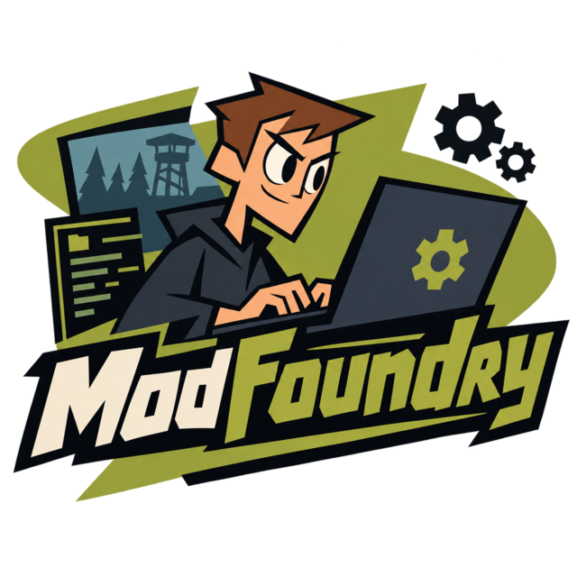

  

<h1 align="center">ModFoundry for DayZ</h1>

A native DayZ modding toolchain for AI agents: one CLI, <code>mf</code>, and an MCP server.

---

ModFoundry lets an agent such as Claude Code write, check, build, run and publish DayZ mods natively on Linux,
without Windows-only tools in the everyday loop. Everything is one native program; the CLI and the MCP server run the same commands and report
the same `MF-*` diagnostics.

What it does:

- **Enforce Script:** lint, outline, go-to-definition, hover and completion data, and the compile errors the game
  itself would print for the retail server, Diag server and Diag client, without starting the game.
- **Configs and economy:** `config.cpp` validation, structural edits that keep comments, `config.bin` binarize and
  derapify, Central Economy XML validation, edits and coverage.
- **Build and sign:** deterministic PBO packing, native `.bikey` / `.bisign` keys and signatures, signature checks.
- **Run and read logs:** launch DayZServer, the Diag server and client, or the client under Proton, capture the logs,
  and map every script error back to its source line.
- **Game updates:** snapshot a DayZ build, diff two builds, and list where mods use what changed; check several mods
  for conflicts.
- **Art and UI:** PNG to `.edds` / `.paa`, imagesets, fonts, and `.layout` checks.
- **Search:** a local index of the game's scripts, configs, layouts and your docs, with keyword and meaning ranking.
- **Workshop:** item details, preview and upload through the running Steam client.
- **Guard rails:** every change can be previewed first and undone; agents act under a policy you control, and every
  call is written to an audit trail.

## Get started

- [INSTALL.md](INSTALL.md): download, install, connect it to Claude Code or another MCP client, or build from source.
- [USAGE.md](USAGE.md): the commands and MCP tools, the agent policy, and good habits. Point your agent at this file.
- [CHANGELOG.md](CHANGELOG.md): what changed in each release (`mf changelog` prints it too).

Releases are on the [Releases page](https://github.com/HellboundGlory/ModFoundry-DayZ/releases), one per version
tag. Linux x86_64 is the only tested platform. `mf update` installs a newer release over a release install.

## Roadmap

Today ModFoundry is the CLI and the MCP server: everything an agent needs to work on a mod. A desktop IDE for people,
built on the same commands, is being worked on and is planned for a future release.

## Disclaimer

ModFoundry is an independent project. It is not made, endorsed or supported by Bohemia Interactive or Valve.
DayZ is a trademark of Bohemia Interactive a.s.; Steam and Steamworks are trademarks of Valve Corporation. All other
trademarks belong to their owners.

- **No game files are included.** You need your own copy of DayZ (and DayZ Server or DayZ Tools where a command uses
  them). ModFoundry reads your installed game; it does not ship or redistribute any of it.
- **Follow the game's and Steam's terms.** Mods you build and upload are your responsibility, including the Steam
  Workshop terms and Bohemia Interactive's rules for DayZ mods and servers.
- **Agents change files and start programs.** Keep your mods in version control or backed up. Review what an agent
  proposes (`--preview`) before letting it apply changes, launch the game or publish.
- **Provided as is.** The software comes without warranty of any kind; see the [licence](LICENSE). Use it at your own risk.

## Licence

Licensed under the [MIT licence](LICENSE).
Third-party parts and their licences are listed in [THIRD-PARTY.md](THIRD-PARTY.md).
